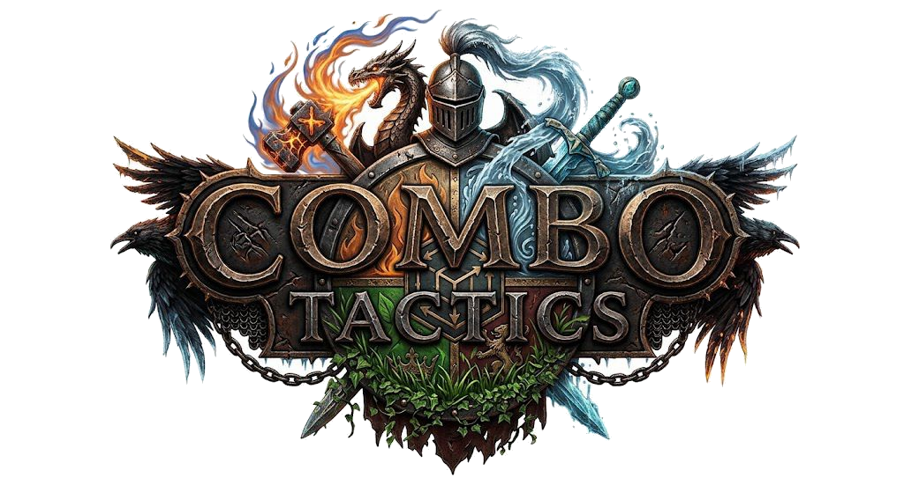

# Combo Tactics

A turn-based tactical RPG for the browser. You manage a team of 3 fighters (Fire, Water or Plant; Warrior, Mage or Tank) in 1v1 arena duels, with a casino-style arena draw every 3 rounds.

RPG tático por turnos para o navegador. Você comanda uma equipe de 3 lutadores (Fogo, Água ou Planta; Guerreiro, Mago ou Tanque) em duelos 1v1 de arena, com um sorteio de arena estilo cassino a cada 3 rodadas.

- **Engine:** Unity 6 (WebGL), C#
- **Modes:** Campaign (4 stages), vs AI, local PvP
- **Status:** playable MVP in [`projeto/game`](projeto/game/README.md)

## Play it

1. Install Unity `6000.0.23f1` (Unity Hub).
2. In Unity Hub: **Add > Add project from disk** and pick `projeto/game`.
3. Open `Assets/_Project/Scenes/Boot.unity` and press **Play**.

Tests: **Window > General > Test Runner > EditMode > Run All**.

## Repository layout

| Path | What it is |
|---|---|
| [`projeto/game`](projeto/game/README.md) | Unity project: battle core, AI, campaign, store, save and UI |
| [`projeto/pt-br`](projeto/pt-br) | Design and architecture documents in Portuguese |
| [`projeto/en`](projeto/en) | The same documents in English |
| [`projeto/NEXT-STEPS.md`](projeto/NEXT-STEPS.md) | Plan, open questions and risks |

## Documents

| Document | English | Português |
|---|---|---|
| Game Design Document | [GDD](projeto/en/GDD.md) | [GDD](projeto/pt-br/GDD.md) |
| Ten-Page Notebook | [caderno](projeto/en/caderno.md) | [caderno](projeto/pt-br/caderno.md) |
| Level Design | [leveldesign](projeto/en/leveldesign.md) | [leveldesign](projeto/pt-br/leveldesign.md) |
| Mechanics | [poderesMecanicas](projeto/en/poderesMecanicas.md) | [poderesMecanicas](projeto/pt-br/poderesMecanicas.md) |
| Architecture | [ARCHITECTURE](projeto/en/architecture/ARCHITECTURE.md) | [ARCHITECTURE](projeto/pt-br/architecture/ARCHITECTURE.md) |
| System Design | [SYSTEM-DESIGN](projeto/en/architecture/SYSTEM-DESIGN.md) | [SYSTEM-DESIGN](projeto/pt-br/architecture/SYSTEM-DESIGN.md) |
| Decision records | [ADRs](projeto/en/architecture/adr/) | [ADRs](projeto/pt-br/architecture/adr/) |

## License

See [`projeto/LICENSE`](projeto/LICENSE). Character sprites are provisional and not covered by it: see the art note in the [game README](projeto/game/README.md#limitações-conhecidas).
