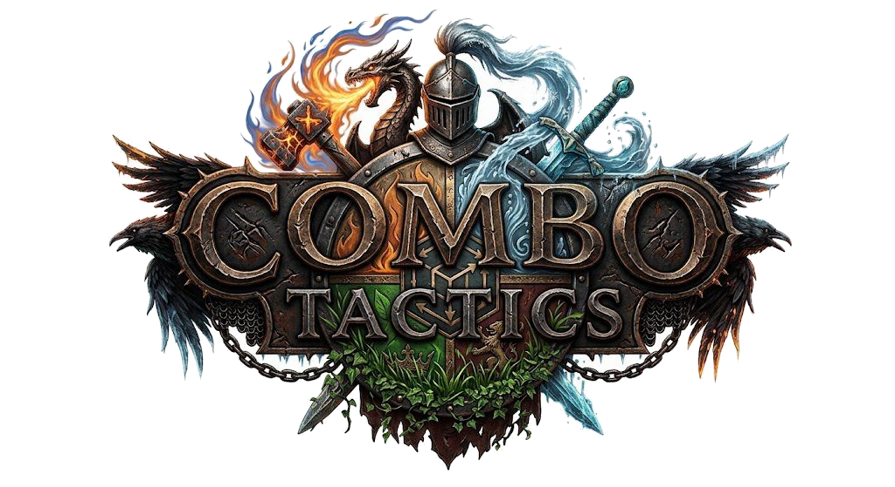
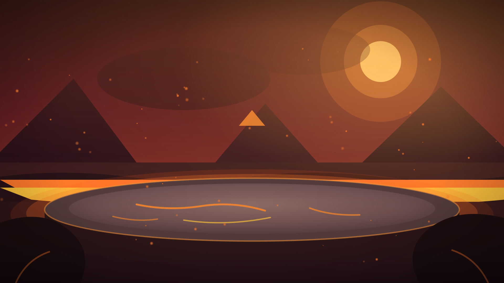
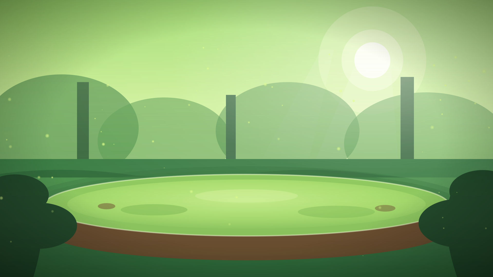
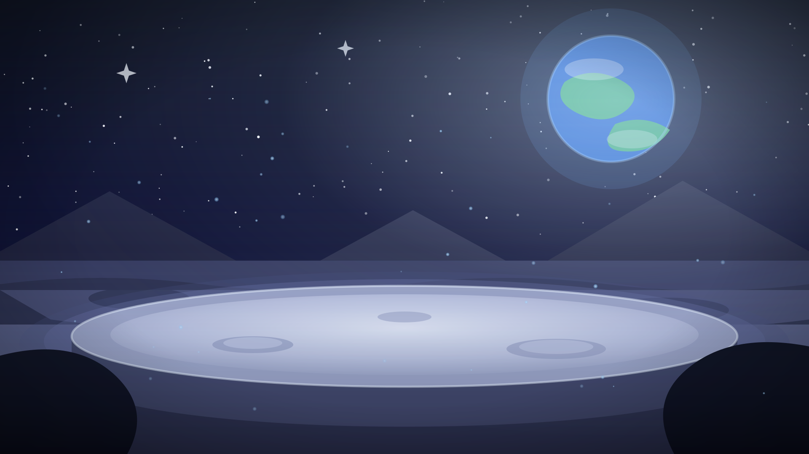
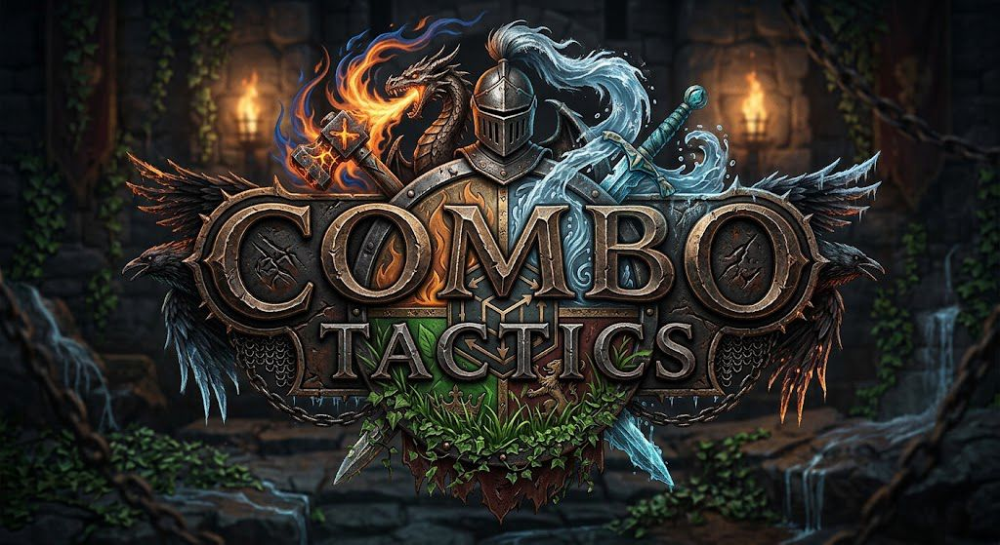

# The Ten-Page Notebook

## Page 1: Game Identity

- **Title:** Combo Tactics
- **Game System:** Turn-based RPG focused on squad management and alternating 1v1 tactical combat.
- **Target Audience:** Tactical RPG fans (14+ years), build optimization enthusiasts, and competitive PvP players.
- **Rating:** 14 years
- **Estimated Release Date:** November 2026

**Logo!**

---

## Page 2: Story and Game Flow

**Story Summary:**

- **Beginning:** The Elemental Crystal kept Fire, Water, and Plant in balance until it shattered and its fragments scattered across the world. Where each fragment fell, an elemental zone was born: the Volcano (Fire), the Sea (Water), and the Forest (Plant). The energy of each fragment awakened the creatures and legends of its zone, who are the game's 9 fighters. The crystal's core, which has no element, ended up on the Moon, and its weight made that zone heavy. You are a spellcasting mage who picks an affinity (Fire, Water, or Plant) and starts the journey with that element's 3 fighters in your spectrum.
- **Middle:** Each fragment is protected by a guardian who fights with the 3 fighters of their zone. The mage faces the guardians of the Volcano, the Sea, and the Forest, in that order. Each victory hands over the zone's fragment, and the defeated fighters join the mage's spectrum (the guardian of the element chosen at the start only hands over the fragment, because those fighters are already in the spectrum).
- **End:** Once the three fragments are gathered, they carry the mage to the Moon. There lives the Core Guardian, a neutral-element creature born from the core, who tests whether the mage is worthy. By defeating it, the mage reunites the Elemental Crystal, the zones return to balance, and the mage becomes the core's new guardian.

**How the story appears in the game:** Through text cards with an image: one at the opening, one before each of the 4 stages, and one at the end.

**Game Flow:** clarify factors such as:

- **Characters:** 9 characters divided into 3 classes (Warrior, Mage, and Tank) and 3 elements (Fire, Water, and Plant). The player starts with the 3 fighters of the chosen element and unlocks the others by defeating the guardians.
- **Environment:** The battle arena is the game environment, it can change during the battle, between Sea, Volcano, Forest, and Moon.
- **Objectives:** In story mode, the objective is to defeat the 3 fragment guardians and then the Core Guardian, to restore the Elemental Crystal.
- **Story Development:** You are a mage commanding a team of 3 fighters, gathering the crystal's fragments and growing your spectrum with every guardian defeated.
- **Types of challenges and how to solve them:** The game's challenges are the battles you have with opponents, in a 3 vs 3 character challenge. Whoever finishes off the opponent's characters first wins.
- **Skill Progression:** Each character has their attributes (HP, attack, defense, speed) and can evolve them in the store.
- **Items:** The player has the option to use an item during the round; possible items are Medical Kit, Medicine, Defense Potion, and Attack Potion.
- **Rewards:** By playing a battle, the player earns coins that can be exchanged for items and skill progression in the store.

---

## Page 3: Main Character

- **Who is the main character:** A spellcasting mage who commands the team of 3 fighters. The mage represents the player commanding the battle.
- **Relevant features for the game:** The mage has an elemental affinity (Fire, Water, or Plant), chosen at the start of the campaign, and a spectrum: the set of fighters the mage can take into battle. The spectrum grows with every guardian defeated.
- **Background:** A rookie mage who feels the imbalance caused by the shattered Elemental Crystal.
- **How the mage got involved in the plot:** By deciding to gather the crystal's fragments and restore the balance between the zones.
- **Art:** The mage does not appear in the arena; the stylized 2D cartoon art is applied to the 9 fighters and the arenas.
- **How the main character will be controlled:** The mage is not controlled directly; the player acts through the fighters in the three round actions (attack, use item, or switch character).

---

## Page 4: Gameplay and Necessary Resources

**Gameplay:**

- **Game Genre:** Turn-based tactical RPG, with squad management and alternating 1v1 duels.
- **Multiple characters:** There are 9 playable characters, and the player takes 3 per battle, rotating which one is active in the arena. Only fighters in the mage's spectrum can be picked.
- **Level structure:** The story mode is a challenge of 4 consecutive battles: the fragment guardians of the Volcano (Fire), the Sea (Water), and the Forest (Plant), and the Core Guardian on the Moon.
- **Mini-games:** These are the battles outside the story mode, against the AI on a chosen difficulty or against another player, using the fighters already unlocked in the spectrum.
- **Bonus stages:** The game has no bonus stages.

**Necessary Resources:**

- **Platform:** PC browser, no installation required.
- **Necessary components:** Keyboard and mouse, web browser, and internet.
- **Split-screen in multiplayer:** There is no split-screen; the multiplayer is local and both players take turns on the same device each round.
- **Camera movements:** Fixed side camera in the 2D arena, observing the 2 active characters.

---

## Page 5: World

**Images!**

- **Environments:** The arena is single and a draw every 3 rounds transforms its scenery between Sea, Volcano, Forest, and Moon.
    - **Sea:** Arena taken by water, which favors Water characters and disadvantages Fire characters.
    - **Volcano:** Lava arena, which favors Fire characters and disadvantages Plant characters.
    - **Forest:** Arena covered in vegetation, which favors Plant characters and disadvantages Water characters.
    - **Moon:** Arena weighed down by the crystal's core, which favors slow characters and disadvantages fast characters.
- **How environments relate to the story:** Each environment is an elemental zone created by a fragment of the Elemental Crystal, and the Moon holds the core. In the campaign, each battle starts in the zone of the guardian being fought.
- **Expected feelings from the player in each environment:** Casino tension, with relief when the drawn scenery favors the team and anxiety when it favors the opponent.
- **Map or diagram expected from the player about the environment:** The game has no map or exploration.

---

## Page 6: Gestalt — "feeling the game"

**What the game conveys with:**

- **Music:** Upbeat, light, and energetic, in the same tone as the 2D cartoon art and the monster duel.
- **Sounds:** The main elements are the voices and roars unique to each of the 9 fighters, giving personality to the creatures.
- **Camera work:** Fixed side camera in the 2D arena, focus on the character when using the special attack.
- **Opening scene:** The menu contains the Campaign, Multiplayer, and Store options in the art below.

**Types of Gestalt:**

- **Horror:** Absent, the game does not deal with fear or survival tension.
- **Hope:** The rookie mage's journey to restore the Elemental Crystal, winning despite the odds.
- **Human:** The weight lies on the characters and the player's bond with their spectrum, which grows with every guardian defeated.
- **Electrifying:** Fast-paced turn adrenaline, dodge window, special attack, and draws turning the tide.
- **Forbidden:** The challenge and the bets set the tone of something underground.

---

## Page 7: Mechanics, hazards, power-ups, and collectibles

- **Mechanics**
    - **Turn actions:** Every turn, the player chooses between attacking, using an item, or switching the active character in the arena.
    - **Effectiveness:** Element and class advantages change damage, +30% for single advantage and +50% for double advantage.
    - **Stamina:** A bar that charges when dealing damage, taking damage, and defending successfully, unlocking the special attack when full.
    - **Dodge and counter-attack:** At the moment of the attack, the targeted user can dodge or counter-attack the opponent by clicking at the right moment.
    - **Arena draw:** Every 3 rounds, a casino draw changes the environment, favoring some characters and disadvantaging others.
    - **3-turn effects:** Special attacks can apply positive or negative effects on other characters.

- **Hazards:** The game has no hazards; all damage comes from battles.

**Power-ups:** The mechanics that help facilitate the game are: Items, Positive effects, Special attacks.

**Collectibles:** At the end of every battle, the player receives coins in return (50 upon defeat, 100 upon victory, and 500 for winning the tournament).

---

## Page 8: Enemies and Bosses

- **Enemies**

    - **Location:** The campaign is a trail where the mage duels 4 opponents, each in their own zone: the fragment guardians in the Volcano, the Sea, and the Forest, and the Core Guardian on the Moon.
    - **Features:** The 3 fragment guardians battle with the 3 fighters of their element, making the elemental weakness predictable.

- **Bosses**

    - **What makes them different?** The final boss is the Core Guardian, a neutral-element creature born from the crystal's core, who fights alone and is much stronger than the 9 fighters.
    - **Are they villains?** No. The guardians protect the fragments and the core, and test whether the mage is worthy of restoring the crystal.
    - **Do they join your side?** Yes. Defeating a fragment guardian adds the 3 defeated fighters to the mage's spectrum. The Core Guardian does not become playable.

---

## Page 9: Unlockables and Multiplayer

**Extra elements that can be unlocked:**

- **Impact on replay:** The attribute evolution bought in the store is permanent and gives a reason to repeat battles accumulating coins.
- **How they are achieved:** The store sells items and evolutions in exchange for coins. Each campaign guardian is only unlocked after beating the previous stage, and defeating a fragment guardian unlocks that element's 3 fighters in the spectrum (which applies to every mode).
- **Achieved inside or outside the game:** Everything is achieved inside the game, by battling and spending the coins earned in battles.

**Multiplayer:**

- **Will there be support?** Yes, local multiplayer is one of the game modes.
- **How many?** Two-player battle, one against the other with teams of 3 characters, picked from the fighters unlocked in the spectrum.
- **How do maps and shared elements behave?** Everything is shared on a single screen: team selection, arena, and scenery draw.
- **Player content creation:** The game has no character, arena, or rule editor.

---

## Page 10: Monetization

- **Free-to-play?** Yes, the game is free on the browser.
- **Pay to play the full version?** No, the entire campaign, multiplayer, and the 9 characters are unlocked by playing, without paying anything.
- **Pay to advance faster or unlock without playing?** Not in the MVP. Coin packages for items and evolutions are planned for after launch, once the game has accounts and a server to validate purchases.
- **Pay to have an advantage over other players?** Not in the MVP. If coin packages are added later, the advantage would be indirect (items and evolutions), and local PvP's Fair Mode keeps matches on base attributes.
- **Unlockable advertising?** The game has no ads, neither mandatory nor optional for rewards.
